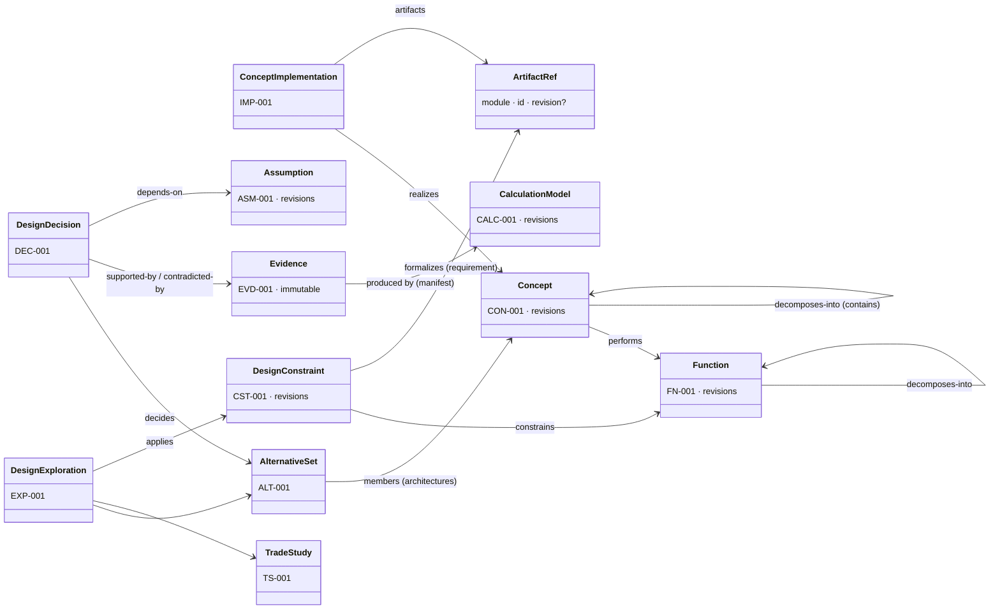

# B. Domain model

Status: Proposed. Index: [README.md](README.md). Changes to Conceptualize are requested in
[contract-change-requests.md](contract-change-requests.md); this document is the target model they lead to.

## 1. Ownership at a glance



Everything in the diagram is **Conceptualize data** (schema `conceptualize`). The Reasoning Engine owns
only the operational entities of §9. Requirements, SysML, CAD, components and verification records are
referenced by `ArtifactRef` and never copied.

Shared conventions (all Conceptualize entities, as today): UUID identity plus a display key unique per
project; immutable revisions for content; ETag/expected revision on writes; idempotency keys; provenance
on every write (actor, source kind `user | assistant | reasoning | import | system`, conversation,
proposal, message, and for `reasoning` also `runId` and `stepId`); removal recorded, never deleted;
audit events and outbox events after commit.

## 2. DesignRef: one way to point at design knowledge

```ts
// SDK (CR-S1). Conceptualize-owned records referenced from anywhere, including other modules.
type DesignEntityType = 'function' | 'concept' | 'implementation' | 'constraint' | 'assumption'
  | 'evidence' | 'decision' | 'alternative-set' | 'trade-study' | 'exploration' | 'calculation-model'
  | 'statement'
interface DesignRef { module: 'conceptualize'; type: DesignEntityType; id: string; revision?: number }
```

`ArtifactRef.module` gains `'conceptualize'` and `'reasoning'` so that other modules (and evidence) can
point at design records and at reasoning runs with the same shape.

## 3. Function (new, CR-C1)

What a system must accomplish, independent of how.

| Field | Notes |
| --- | --- |
| `name`, `verbPhrase` | e.g. "Transmit mechanical power"; `verbPhrase` is optional structured text (verb, object) used for search and for function-means views |
| `description`, `purpose` | Free text |
| `flows` | Inputs and outputs: `{ direction: in | out, kind: energy | material | signal | force | data | other, name, quantity? }` (CPM transfer-function idea, kept small) |
| `desiredBehaviors` | Statements (existing statement infrastructure, kind `behavior`) |
| `performanceObjectives` | `{ name, quantity (value or range, unit), direction: min | max | target, basis }` |
| `interfaces` | Statements of kind `interface`, plus `interfaces-with` links to other Functions |
| `classifications` | User-defined taxonomy terms (extension mechanism, knowledge-representation.md §6) |
| `status` | `draft | active | retired` (no maturity ladder: a function is not "implemented") |

Invariants:

- A Function has **no implementation and no geometry**; it never appears in `ConceptImplementation.conceptIds`
  and never as an alternative-set member.
- Function decomposition (`decomposes-into`, Function → Function) is acyclic over all decompositions;
  a sub-function may be shared by several parents.
- A Concept **performs** zero or more Functions; a Function may be performed by many alternative
  Concepts. That multiplicity is what makes alternatives comparable: alternatives in one set must
  perform the same parent Function (validated on set creation when the set has a `functionId`, CR-C7).
- Requirements relate to Functions by `ArtifactRef` links (`satisfies`, `derives`, `refines`, `proposes`
  as today's concept links), never by copying requirement text.

Function–means view: Function → (performed by) Concepts → (decomposed into) sub-Concepts → (perform)
sub-Functions. This is the enhanced function-means tree and the axiomatic-design zigzag
([research note §3](../../research/design-reasoning/research-note.md#3-what-the-architecture-takes-and-what-it-leaves-out))
without a separate store.

## 4. Concept (existing, extended)

Unchanged identity, revisions, statements with basis, maturity, verification status, relationships,
decompositions. Changes:

- New link `performs` (Concept → Function) replaces the current use of `implements` towards a Concept
  whose abstraction is `function` (migration in CR-C1).
- `abstraction: 'function'` stays readable for compatibility (SDK enum unchanged) but new function-level
  records are created as Functions; the UI offers "Convert to Function" (an explicit, previewed
  operation that creates the Function, links `derived-from`, and leaves the old Concept as history).
- Concept attributes remain `{ value, unit, min?, max?, basis }` quantities; they may be bound as
  inputs of calculation models (§8).

## 5. DesignConstraint (new, CR-C2)

An engineering limitation or condition at conceptual level.

| Field | Notes |
| --- | --- |
| `kind` | `qualitative | logical | mathematical | dimensional | interface` |
| `statement` | Natural-language text (always present) |
| `bound` | Optional quantity bound: `{ symbol?, operator: <= | < | = | >= | > | in-range, quantity }` |
| `expression` | Optional reference to a CalculationModel relation (`{ modelId, revision, relationId }`) for mathematical constraints |
| `strength` | `hard | soft | preference` (MDO: constraint vs objective vs preference) |
| `subjects` | DesignRefs it constrains (Functions, Concepts, interfaces, explorations) via `constrains` links |
| `source` | `{ kind: requirement, ref: ArtifactRef (module requirements, pinned revision) }`, `{ kind: derived, from: DesignRef }`, `{ kind: stated }` (user or AI, with basis) |
| `status` | `proposed | active | relaxed | retired`, plus derived `suspect` when its source requirement revision is no longer current |

**Relationship to Requirements (no duplication):**

1. A constraint that **formalizes** a requirement stores only the formalization (bound, expression) and a
   pinned `ArtifactRef` to the requirement revision. The statement shown is read from Requirements; the
   constraint's own `statement` explains the formalization ("REQ-001 operating load as F ≥ 12 kN").
2. A **conceptual** constraint that is not a requirement may later be **proposed** as a requirement:
   a previewed proposal calls `RequirementsService.create` (a draft), then links `proposes`. Approval
   stays in Requirements. The constraint never becomes an approved requirement by itself.
3. When the pinned requirement revision is superseded, the constraint becomes `suspect` and enters
   impact analysis; nobody rewrites it silently.

## 6. Alternatives, decisions and rationale (existing, extended)

**AlternativeSet** (existing `alternative_sets`): a question under a parent with member Concepts. Changes
(CR-C7): optional `functionId` (the function all members perform); a member may name a
`decompositionId`, so that an alternative is a **complete architecture** (the Concept plus one of its
decomposition structures), not only a single concept; member status changes only by decisions (as today);
"reconsider" reopens a decided set by a new proposed decision that supersedes the old one.

**DesignDecision** (existing `decisions`; ADR-like, supersede-not-edit). Brief §3 fields and where they live:

| Brief field | Today | Change (CR-C5) |
| --- | --- | --- |
| Decision question | `question` | — |
| Alternatives considered | `set_id` → members, `outcomes[]` | — |
| Selection and rationale | `outcomes[].outcome`, `rationale` | — |
| Supporting evidence | trade study only | `support[]: { ref: DesignRef (evidence, calculation result) , role: supports | contradicts, note }` |
| Assumptions | — | `assumptionIds[]` (pinned revisions) |
| Constraints | — | `constraintIds[]` (pinned revisions) |
| Approval status | `status: proposed | recorded | withdrawn`, `recorded_by` (reviewer gate) | — |
| Author and provenance | `proposed_by`, `recorded_by`, source kind | add `runId` |
| Affected artifacts | — | `affected[]: (DesignRef | ArtifactRef)` |
| Invalidation conditions | — | `invalidationConditions[]` (below) |
| — | — | derived `validity: valid | under-review | invalidated` |

```ts
interface InvalidationCondition {
  id: string
  kind: 'assumption-invalidated' | 'constraint-changed' | 'evidence-superseded' | 'requirement-revised'
      | 'artifact-revised' | 'relation-violated' | 'manual'
  subject: DesignRef | ArtifactRef           // what is watched
  relation?: { modelId: string; revision: number; relationId: string } // for 'relation-violated'
  description: string                        // why it would invalidate the decision
}
```

Invariants: a recorded decision's `validity` changes only by (a) the impact analyzer **flagging**
`under-review` when a condition fires (an event plus a notification, no edit of the decision record), or
(b) a reviewer recording `invalidated` or superseding it. Rationale is never rewritten.

**TradeStudy** (existing): criteria, options, append-only scores, server-computed weighted results with
interval bounds and robustness. Extensions (CR-C7): a score may reference the Evidence that produced it
(already `evidence_id`), criteria may reference a performance objective of the Function, and the study
result includes Pareto dominance in addition to the weighted sum ([exploration.md](exploration.md)).

## 7. Assumption (new, CR-C3) and Evidence (extended, CR-C6)

**Assumption**: a separately identifiable, traceable engineering assumption.

| Field | Notes |
| --- | --- |
| `statement`, `quantity?` | e.g. "Rod ends are pinned (K = 1)", `{ value: 1, unit: '-' }` |
| `scope` | `subjects: DesignRef[]` plus optional `applicability` (configuration IDs, operating conditions text) |
| `validationStatus` | `unvalidated | under-review | validated | invalidated | retired` |
| `basis` | `user-assertion | ai-hypothesis | assumption` (initially), see ADR-0043 |
| `dependsOn` | DesignRefs or ArtifactRefs (other assumptions, evidence, requirements) |
| `validatedBy` | Evidence refs, with the person who recorded validation |

Validation and invalidation are explicit records (actor, time, reason, evidence). The AI may propose an
assumption and propose its validation, but `validated` needs a person with author rights and an evidence
reference; `invalidated` can be proposed by the impact analyzer and recorded by a person.

**Evidence** (existing, immutable). Additions:

| Field | Notes |
| --- | --- |
| `subjects[]` | DesignRefs (today: exactly one concept). Existing rows keep `concept_id` as their one subject |
| `version` | Position in the supersession chain (existing `supersedes_id`) |
| `applicability` | Concept/function revisions, configuration, conditions it is valid for |
| `basis` | Ladder of ADR-0043: `ai-hypothesis | assumption | assessment | estimate | calculated | evidence` |
| `validation` | Append-only review records `{ outcome: accepted | rejected, reviewer, method, at, note }`; derived `validationStatus` |
| `manifest` | For `calculated`: the reproducibility manifest of [mathematics.md §6](mathematics.md#6-execution-results-and-the-reproducibility-manifest) |
| `source` | ArtifactRef to an external authority (standard, test report, analysis result, twin verification record) |

## 8. CalculationModel (new, CR-C8)

A mathematical model definition, separate from its executions. Defined in [mathematics.md](mathematics.md):
parameters with units and roles, relations (assignments, constraints, objectives), assumptions, validity
range, basis and validation status. Executions are Evidence with a manifest. Conceptualize owns definitions
until a Mathematics module exists (platform roadmap phase 3); then ownership moves by ADR and Conceptualize
keeps `ArtifactRef`s (additive).

## 9. DesignExploration (extended, CR-C7)

Today `explorations` record an atomic creation of a parent, a set and a study (with undo). Target:

| Field | Notes |
| --- | --- |
| `question` | The design question (today's `objective`) |
| `objectives[]` | `{ name, direction: minimize | maximize | target, quantity?, criterionId?, functionObjectiveRef? }` |
| `constraintIds[]` | Applicable DesignConstraints (pinned) |
| `designSpace` | `{ fixed: [{ ref, reason }], variable: [{ ref or symbol, bounds?, levels? }] }`: which characteristics may vary |
| `alternativeSetIds[]`, `tradeStudyIds[]` | The candidates and their comparison |
| `investigations[]` | `{ id, title, kind: calculation | analysis | review | search | other, status: planned | running | done | abandoned, runRef?: ArtifactRef(module reasoning), evidenceIds[] }` |
| `uncertainties` | Statement refs of kind `question` / `uncertainty` still open |
| `decisionIds[]` | Decisions recorded from this exploration |
| `convergence` | `{ criteria: text + optional rules, status: open | converged | closed | reopened, note }` |
| `generation` | Today's `created_ids`, `generator`, `undone` kept as the record of how its first content was created |

Durable vs temporary: the exploration and everything it references are durable design knowledge; the
runs that performed its investigations are operational records in the engine, referenced by ID
(`runRef`) so that the design record survives deletion of run detail under a retention policy.

## 10. Operational entities (Reasoning Engine, schema `reasoning`)

| Entity | Purpose | Lifecycle |
| --- | --- | --- |
| `ReasoningRun` | One investigation or tool-assisted answer: question, mode (`assistant-driven | engine-driven`), captured context, budget, status, outcome summary | `created → planned → running ⇄ paused → completed | failed | cancelled | budget-exhausted` |
| `ReasoningPlan` (+ `PlanStep`) | Structured plan: goal, unknowns, assumptions to test, steps with required tool, expected evidence, dependencies | `draft → accepted (by user or policy) → superseded` |
| `ToolInvocation` | One tool call: tool name and version, input (validated), output digest and payload, duration, error, idempotency key | immutable |
| `ContextManifest` | What the run used: refs with revisions, retrieval route, digest, omissions | immutable per step |
| `Checkpoint` | Resumable state after a step: completed step IDs, pending steps, budget consumed | append-only |
| `ProposalDraft` | A serializable proposal before Apply (ADR-0042): operations, preview items, basis, evidence, uncertainty, required approvals | `draft → offered → applied | rejected | expired | superseded` |
| `Justification` | Concise explicit engineering justification attached to a step or draft (not model chain-of-thought) | immutable |

Invariants: the engine never stores an authoritative copy of a design record; every ref it stores is a
`DesignRef` or `ArtifactRef` with a revision; a `ProposalDraft` that has been applied records the
committed IDs and revisions returned by the owning module.

## 11. Lifecycle semantics summary

| Entity | States | Who changes them |
| --- | --- | --- |
| Concept maturity | idea … archived (existing, non-linear, gated from `selected`) | editor / reviewer (existing rules) |
| Function | draft, active, retired | editor |
| Constraint | proposed, active, relaxed, retired (+ derived suspect) | editor; relaxing a `hard` constraint that formalizes a requirement needs reviewer |
| Assumption | unvalidated, under-review, validated, invalidated, retired | editor proposes; validated/invalidated need an evidence ref; invalidating one referenced by a recorded decision needs reviewer |
| Evidence | immutable; validation status derived from review records | reviewer records acceptance of `evidence` basis |
| Decision | proposed, recorded, withdrawn (+ superseded); validity valid / under-review / invalidated | reviewer records; impact analyzer only flags |
| Exploration | open, converged, closed, reopened | editor; closing with recorded decisions needs reviewer |
| ReasoningRun | see §10 | the engine; user cancels |

## 12. Mapping from today's Conceptualize model

| Brief entity | Today on `feature/conceptualize` (b5e2668) | Target | CR |
| --- | --- | --- | --- |
| Function | Concept with `abstraction: 'function'`, or statement kind `function`; solution → function via `implements` | Function entity; `performs` | C1 |
| Concept | Concept | Concept + `performs` | C1 |
| ConceptImplementation | `implementations`, `implementation_artifacts`, `realization_requests` | + realized concept revision, sync state, deviations | C11 |
| DesignDecision | `decisions` | + support, assumptions, constraints, affected, invalidation conditions, validity | C5 |
| Assumption | statement kind `assumption` or basis `assumption` | Assumption entity; statements migrated by reference | C3 |
| Evidence | `evidence` (one concept, basis, inputs/outputs) | + subjects, applicability, validation reviews, manifest, wider basis | C6 |
| Constraint | statement kind `constraint` with quantity | DesignConstraint entity | C2 |
| Alternative | `alternative_sets` + members (Concepts) | + function, member decomposition (architecture), reconsider | C7 |
| DesignExploration | `explorations` (bulk-create log) | Structured exploration | C7 |
| Relationships | 9 Concept↔Concept types | Typed design links across entity types + registry | C4 |
| Calculation model | evidence `method` text (e.g. Euler buckling in the seed) | CalculationModel + calculated evidence | C8 |
