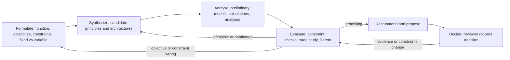

# G. Design exploration architecture

Status: Proposed. Index: [README.md](README.md). Records: DesignExploration, AlternativeSet,
TradeStudy (Conceptualize, CR-C7); runs and drafts (engine).

## 1. Concepts

| Term | Meaning | Where |
| --- | --- | --- |
| Exploration | A structured investigation of one design question with objectives, constraints and a design space | Conceptualize `DesignExploration` |
| Design space | Which characteristics are **fixed** (interfaces, approved requirements, envelope) and which may **vary** (design variables with bounds, choice of principle, decomposition) | `designSpace` on the exploration |
| Branch | One candidate architecture: a Concept (with its decomposition) in an alternative set | Alternative set member |
| Investigation | A planned piece of work that produces evidence for the comparison (calculation, analysis, review) | `investigations[]`, performed by runs |
| Draft branch | A branch that exists only inside an engine run (phase 3) until the user applies it | Engine `ProposalDraft` |
| Convergence | The criterion for stopping: a recorded decision, a robust ranking, exhausted budget, or the user's call | `convergence` |

Branches never overwrite each other: every branch is its own Concept identity (as today in
Conceptualize), derived from the parent with `derived-from` when it is a variant of another branch.

## 2. Iterative loop (FBS vocabulary, MDO formulation)

Reformulation is explicit: changing an objective or a constraint in an exploration is a new revision of the
exploration (or the constraint) with a reason, and the evaluation results built on the old formulation
become stale (impact analyzer).

## 3. Comparison and convergence

1. **Feasibility screen**: every hard constraint is checked per branch (`evaluate_constraint`). Branches with
   a demonstrated violation are **infeasible**; branches with no deterministic check stay **unknown**, never
   assumed feasible.
2. **Trade study**: Conceptualize's weighted-sum evaluation (normalized scores, interval bounds, coverage,
   robustness; preliminary unless every score is evidence).
3. **Pareto dominance** over the exploration's objectives (computed by `design-reasoning-core`): a branch is
   dominated if another is at least as good on every objective and better on one; with ranges, dominance is
   claimed only when it holds for interval bounds ("robustly dominated"), otherwise "possibly dominated".
   Weighted sums are shown alongside Pareto results because weighted sums cannot find non-convex trade-offs
   (Martins and Ning, ch. 9).
4. **Recommendation**: the engine recommends branches that are feasible and non-dominated, states the
   deciding criteria and the uncertainty, and lists the investigations that would most change the ranking
   (the criteria whose score ranges overlap most).
5. **Convergence criteria** (configurable on the exploration): robust ranking of the top branch; coverage ≥ a
   threshold; no open `question` statements marked blocking; or budget exhausted. Convergence is a status
   that a person sets (or confirms when the engine proposes it); it is not a decision.

## 4. Scenario: "reduce the mass of this assembly by 20 % while preserving stiffness and load capacity"

| Brief step | What happens | Records and tools |
| --- | --- | --- |
| 1 Retrieve functional intent | Resolve the assembly (twin ID, client-attested) → implementations → realized Concepts → performed Functions | `retrieve_design_context` (change/feasibility profile) |
| 2 Applicable constraints | Constraints on those Functions and Concepts; formalized requirements (load capacity, stiffness); interface constraints | graph `constrains`, `formalizes`; Requirements API |
| 3 Fixed vs variable | Fixed: interfaces (`interfaces-with`), approved requirements, envelope. Variable: material, section dimensions, principle, decomposition. Shown to the user for confirmation before generation | exploration `designSpace` (draft) |
| 4 Generate alternatives | Model proposes principles (e.g. hollow section, composite tube, different load path); tool validates and drafts | `propose_solution_concepts` |
| 5 Exploration branches | One alternative set under the Function(s), branches as Concepts with decompositions | `create_design_exploration` (draft, batch) |
| 6 Preliminary models | Reuse existing CalculationModels (mass, stiffness, buckling) or draft new ones (`ai-hypothesis`, validated by a person before they support a decision) | CalculationModel drafts |
| 7 Evaluations | Calculations per branch with interval bounds; analysis via `AnalysisPort` (**test adapter**) only where labelled | `evaluate_calculation`, `run_analysis` |
| 8 Compare against objectives | Objective: mass ≤ 0.8 × baseline mass (baseline pinned); constraints: stiffness ≥ baseline, load capacity ≥ requirement | `compare_alternatives` |
| 9 Infeasible alternatives | Demonstrated violations marked; unknowns listed | feasibility screen |
| 10 Recommend | Feasible, non-dominated branches with deciding criteria and uncertainty | evaluator |
| 11 Preserve reasoning | Exploration, branches, evidence, investigations with run refs; rejected branches kept | Conceptualize records; run records |
| 12 Propose for review | One bundled draft: exploration update, evidence, proposed decision (`requiredApprovals: decide`), realization requests for CAD | ProposalDraft → Apply |

No step changes the approved baseline or the CAD model; the CAD change, if chosen, is a realization
request to the CAD module, which today has no generation API (it stays pending).

## 5. Parallel exploration (phase 3)

- A parent run forks **branch runs**, one per branch, each with a budget slice, its own checkpoints and
  manifests. Branch runs are independent (no shared mutable state); they write only to engine records.
- Results meet in the parent: comparison, recommendation, one bundled ProposalDraft.
- Concurrency limit per project and per user; cancellation of the parent cancels branches.
- Reproducibility: each branch's deterministic steps replay independently; model steps are recorded as
  hypotheses with model identifiers.
- Phase 2 keeps the same schema (`parentRunId`, `branchKey`) but executes sequentially; no queue or worker
  pool is needed until phase 3 (ADR at that point).

## 6. Learning across explorations (phase 3, bounded)

"Design-space learning" is limited to **retrieval and statistics over recorded data**: which principles
were explored for similar functions, which were rejected and why, how calculated predictions compared with
later verified evidence. Results are shown as context with refs; they never become evidence or change any
record. Surrogate models (Martins and Ning, ch. 10) are a calculation-engine extension, recorded with their
training data references, and labelled `estimate`.

## 7. Guard rails

- No unrestricted autonomous modification of approved baselines: engine-driven runs have **no write
  operations**; their output is drafts.
- Budgets (steps, tool calls, model tokens, compute time, drafts) and cancellation on every run.
- Hard constraints from approved requirements are fixed in the design space unless the user explicitly moves
  them to variable (recorded with a reason); relaxing them later still needs the Requirements process.
- AI-generated estimates stay labelled; a branch recommended on preliminary evidence says so.
