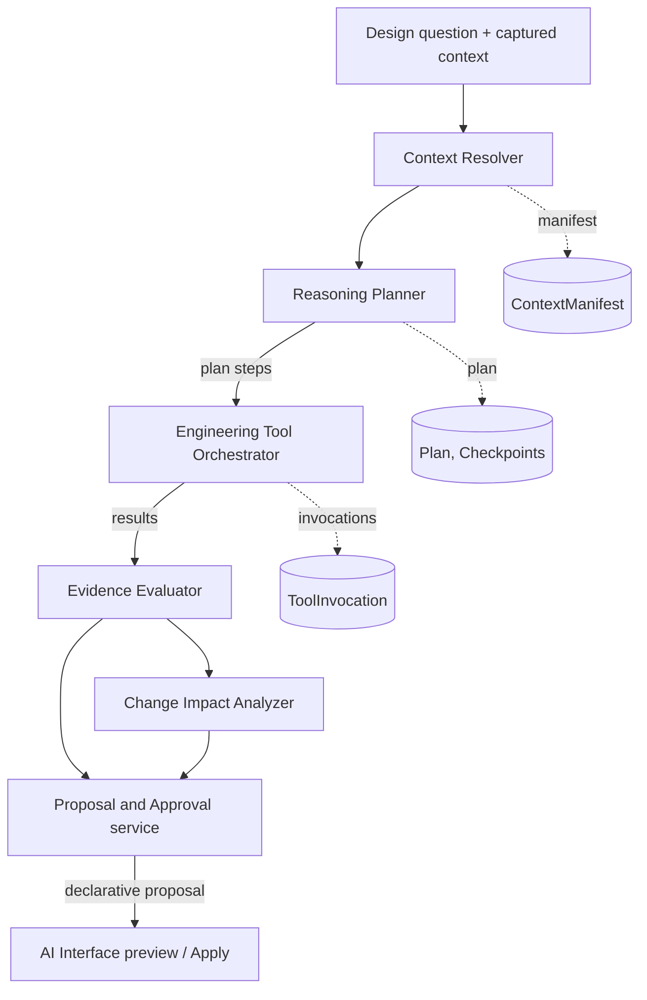

# D. Reasoning orchestration

Status: Proposed. Decisions: [ADR-0039](../../decisions/0039-design-reasoning-engine-boundary.md),
[ADR-0043](../../decisions/0043-basis-of-knowledge-and-promotion.md),
[ADR-0045](../../decisions/0045-reasoning-runs-and-model-access.md),
[ADR-0046](../../decisions/0046-change-impact-and-invalidation.md). Index: [README.md](README.md).

## 1. Shape of the engine

The engine is an orchestrated, tool-using service with six components. The **language model interprets,
plans and explains**; **deterministic code** retrieves, calculates, compares and traverses. Each
component is a module of `services/design-reasoning` over the framework-free `@ews/design-reasoning-core`.



Two modes share the components (ADR-0045):

| Mode | Who sequences steps | Model access | Phase |
| --- | --- | --- | --- |
| Assistant-driven | The conversation model in the AI Interface calls `reasoning.*` tools one at a time; each call is a step of a run | Not needed by the engine | 2 |
| Engine-driven | The engine's planner loop executes an accepted plan; steps that need language (generate candidates, interpret a result) are requested through the AI Interface **model gateway** | AI Interface gateway (CR-A3) | 3 |

## 2. Context Resolver

Input: a question (text), a captured context (project, configuration, scenario, model revision,
selection: today's `CapturedActionContext`), optional seed refs, and a context budget (max items, max
characters). Output: a **ContextPackage** (typed records) plus a **ContextManifest** (what was used).

Resolution strategy, cheapest and most exact first:

1. **Seeds**: refs given explicitly (selection, the exploration, the decision asked about).
2. **Graph traversal** in Conceptualize from the seeds with a question-type profile:

   | Question type | Follow | Depth |
   | --- | --- | --- |
   | Rationale ("why selected") | `selected-through`, decision `support`, assumptions, constraints, alternative set | 2 |
   | Alternatives ("what was rejected") | alternative sets of the subject's function, decisions, trade studies | 2 |
   | Change ("what if this changes") | reverse dependency types with impact propagation ≠ none (ADR-0046) | 4 |
   | Assumptions ("which assumptions support") | `depends-on` and decision assumptions, transitively | 3 |
   | New principle ("completely different way") | the Function, its constraints and objectives, existing performers (to avoid duplicates) | 1 |
3. **Requirements**: `RequirementsService.get` / `traceLinks` / `impact` for requirement refs found in
   step 2 (formalized and linked requirements), scoped by configuration.
4. **Twin** (components, SysML, CAD, verification records): the twin lives in the browser repository
   today. The browser executor attaches a **client-attested twin snapshot** for refs the resolver asks
   for (ID, type, revision, the requested properties, `represents` and other relationships) and the
   resolver labels these items `via: client-attested` (CR-P1). When the twin moves server-side the
   route changes; the manifest format does not.
5. **Full-text search** in Conceptualize for terms of the question when steps 1–4 return too little.
6. **Embeddings** only if introduced later (knowledge-representation.md §4.3).

Rules:

- Retrieve only what the question type needs; cut by relevance (graph distance, then recency) to the
  budget, and record what was omitted (`omitted: { count, reason }`).
- Every item carries its **revision**. A later read inside the same run that sees a different revision
  marks the run's earlier results `stale-input` and the evaluator downgrades conclusions built on them.
- Record content is **data, not instructions**: when passed to a model it is wrapped as quoted data with
  its ref; nothing in it can add tools or change scope (governance-security.md §5).

```ts
interface ContextManifest {
  runId: string; stepId: string; builtAt: string
  items: { ref: DesignRef | ArtifactRef; revision: number | null; via: 'seed' | 'graph' | 'filter'
           | 'search' | 'requirements-api' | 'client-attested'; digest: string; fields: string[] }[]
  omitted: { count: number; reason: 'budget' | 'not-authorized' | 'not-found' }[]
}
```

Authorization: the resolver reads **as the user** (forwarded identity, the same roles and entitlements as
the UI). Items the user may not read are omitted with reason `not-authorized` and never reach a model.

## 3. Reasoning Planner

Turns a question into a structured, inspectable plan. A plan is data validated by the engine regardless
of who wrote it (template, model or person).

```ts
interface ReasoningPlan {
  id: string; runId: string; revision: number
  goal: string                                  // one sentence
  questionType: 'rationale' | 'alternatives' | 'change-impact' | 'feasibility' | 'comparison'
              | 'new-principles' | 'implementation-impact' | 'other'
  unknowns: { id: string; text: string; resolvedBy?: string }[]       // step id
  assumptionsToTest: { text: string; assumptionRef?: DesignRef }[]
  steps: {
    id: string; title: string
    tool: string                                 // registered tool name, e.g. 'reasoning.evaluate_calculation'
    inputs: Record<string, unknown>              // validated against the tool's input schema
    dependsOn: string[]
    expectedEvidence: { kind: 'calculation' | 'comparison' | 'impact' | 'context' | 'analysis' | 'judgement';
                        basisCeiling: Basis }     // the best basis this step can produce (ADR-0043)
    budget?: { maxToolCalls?: number; maxMs?: number }
  }[]
  stopWhen: string                               // convergence / completion criterion, plain text + optional rule
}
```

Validation: every step names a registered tool the user is entitled to; inputs match its schema; the step
graph is acyclic; the `basisCeiling` cannot exceed what the tool can produce (a model "judgement" step can
never promise `calculated`); budgets fit within the run budget.

Sources of plans:

- **Templates** (phase 2, no model needed): one per question type, parameterized by the context, e.g.
  change impact = resolve → traverse → re-evaluate affected calculations → evaluate invalidation
  conditions → classify → draft notifications.
- **Model-proposed** (phase 2 via the assistant, phase 3 via the gateway): the model submits a plan
  through `reasoning.plan_investigation`; the engine validates it and shows it. In engine-driven mode a
  plan whose steps include job-class tools or model steps beyond a threshold needs the user's acceptance
  before it runs (scoped authorization, governance-security.md §4).

## 4. Engineering Tool Orchestrator

Executes plan steps by calling **registered tools** through adapters. Tool classes:

| Class | Examples | Executor |
| --- | --- | --- |
| Query | Conceptualize graph, search, rationale; Requirements get/traceLinks/impact | Module APIs as the user |
| Deterministic calculation | Evaluate a calculation model, check a constraint, interval bounds, unit conversion | `@ews/engineering-calc` (in-process worker thread with time and memory limits) |
| Deterministic comparison | Trade-study result (Conceptualize computes), Pareto dominance, sensitivity | Conceptualize API / `design-reasoning-core` |
| Impact | Dependency traversal, invalidation-condition evaluation | `design-reasoning-core` |
| Analysis / simulation | Structural, thermal … | `AnalysisPort`: **labelled test adapter** until an Analysis module exists |
| CAD / SysML | Read representation, request realization | Twin via client-attested snapshot; CAD generation is a Conceptualize realization request (no CAD API exists) |
| Optimization | Multiobjective search | Phase 3, behind the calculation-engine port (mathematics.md §8) |

Each invocation is recorded (`ToolInvocation`: tool, tool version, engine version, validated input,
output, digest, duration, error). Retries use the invocation's idempotency key; deterministic tools are
pure, so a replay with the same inputs must produce the same output digest (reproducibility check).

Errors are structured and returned to the caller: `invalid-input`, `not-found`, `forbidden`,
`not-entitled`, `stale-context`, `unit-error`, `domain-error` (e.g. calculation outside validity range),
`budget-exhausted`, `cancelled`, `unavailable`, `not-implemented` (honest gap: e.g. no analysis module).

## 5. Evidence Evaluator

Classifies every result a run produces on the **basis ladder** (ADR-0043) and enforces promotion rules:

| Level | Basis | Produced by | Can the engine assign it? |
| --- | --- | --- | --- |
| Hypothesis | `ai-hypothesis` | model output | yes |
| Assumption | `assumption` | model or person, explicitly marked | yes (as proposal) |
| Qualitative assessment | `assessment` | model or person judgement on a scale | yes (as proposal) |
| Preliminary estimate | `estimate` | hand-style calculation with stated assumptions, not via a registered model | yes |
| Calculated result | `calculated` | a registered CalculationModel revision executed by the deterministic engine with a manifest; reproducible | **only** from a ToolInvocation of the calculation engine; Conceptualize re-verifies (CR-C8) |
| Verified result | `evidence` | verification-grade evidence accepted by a reviewer, or a twin verification record | **never**; a person records it |
| Approved decision | `decision` | recorded design decision | **never**; a reviewer records it |

Additional rules:

- A conclusion's basis is the **minimum** of the bases it depends on (a calculation fed by an
  `ai-hypothesis` input is reported as `calculated (inputs: hypothesis)` and stored as `estimate` unless
  every input is at least `assumption` with an explicit Assumption record).
- Stale inputs (revision changed during the run) downgrade dependent conclusions to `stale`.
- Outside a model's declared validity range a calculated result is reported with a `domain-warning` and
  cannot support a decision without a person's override recorded in the proposal.
- The evaluator produces a short **justification** for each conclusion (what it rests on, by ref), never
  the model's private reasoning.

## 6. Change Impact Analyzer

Algorithm (in `@ews/design-reasoning-core`, ADR-0046):

1. **Seed** with the change: a ref and a delta (new revision, changed value, removed link, invalidated
   assumption, revised requirement).
2. **Traverse** reverse along link types whose propagation is not `none`, across Conceptualize (graph
   API), Requirements (trace links, impact) and the twin (relationships, `changeImpact` from
   `@ews/model-service` for twin-side dependents when run in the browser). Stop at depth 6 or budget.
3. Mark each reached item **possible**, with the path that reaches it.
4. **Demonstrate** where a deterministic check exists: re-evaluate calculation models whose inputs are
   bound to the changed value; evaluate constraint bounds; compare pinned revisions with current ones;
   evaluate decisions' invalidation conditions. Items whose check fails become **demonstrated**, with the
   evidence (invocation ID, values); items whose check passes become **checked-unaffected**.
5. **Classify** decisions: any demonstrated impact on a decision's assumptions, constraints or support →
   `under-review` flag proposed; implementations whose concept revision is behind → `intent-ahead`.
6. **Report** and **draft** (never apply): notifications, decision review flags, assumption invalidation
   proposals, realization requests.

```ts
interface ImpactReport {
  change: { ref: DesignRef | ArtifactRef; from?: unknown; to?: unknown; description: string }
  items: { ref: DesignRef | ArtifactRef; classification: 'possible' | 'demonstrated' | 'checked-unaffected';
           paths: { linkType: string; from: string; to: string }[][]
           mechanism: string; evidence?: { invocationId: string; summary: string } }[]
  decisionsUnderReview: DesignRef[]; truncated: boolean
}
```

## 7. Proposal and Approval service

Produces **ProposalDrafts** (ADR-0042): serializable descriptions of module operations plus the
information the brief requires. The AI Interface previews them; the user applies them; the owning module
validates and commits.

```ts
interface ProposalDraft {
  id: string; runId: string; status: 'draft' | 'offered' | 'applied' | 'rejected' | 'expired' | 'superseded'
  title: string
  action: string                               // proposed action, one sentence
  rationale: string                            // engineering rationale
  affected: (DesignRef | ArtifactRef)[]
  expectedEffects: string[]
  evidence: { ref: DesignRef | ArtifactRef; basis: Basis }[]
  assumptions: { text: string; ref?: DesignRef }[]
  uncertainty: { summary: string; ranges?: { name: string; min: number; max: number; unit: string }[] }
  requiredApprovals: { permission: 'author' | 'decide'; module: string; reason: string }[]
  operations: ModuleOperation[]                // declarative, applied by the platform (CR-A1)
  preview: ServiceProposalItem[]               // existing SDK shape, extended (CR-S4)
  expiresAt: string                            // drafts expire when inputs change or after 7 days
}
interface ModuleOperation {
  module: 'conceptualize' | 'requirements'
  operationId: string                          // OpenAPI operationId of the owning module
  params: Record<string, string>; body: unknown
  ifMatch?: string; idempotencyKey: string     // = draft id + operation index
  provides?: string                            // placeholder name later operations may use ("$fn1")
}
```

Rules: one draft maps to one atomic module call where possible (Conceptualize batch endpoint, CR-C10);
a multi-module draft is applied as ordered, individually idempotent steps and reports partial completion
honestly (no global transaction is implied). Drafts whose inputs changed (revision mismatch) are re-built
or expire; Apply re-checks `If-Match`. Recording an accepted decision is drafted with
`requiredApprovals: decide`; the module refuses it for a user without the reviewer role, which the preview
already says.

## 8. Runs: budgets, cancellation, checkpoints, reproducibility

```ts
interface RunBudget { maxSteps: number; maxToolCalls: number; maxModelTokens?: number
                      maxWallMs: number; maxComputeMs: number; maxDrafts: number }
```

- **Budgets** are set per run from defaults by mode (assistant-driven: small; engine-driven: user-set
  within a project limit). The orchestrator checks before every step; exhaustion ends the run as
  `budget-exhausted` with completed results preserved.
- **Cancellation**: `POST /runs/{id}/cancel` stops new steps; a running deterministic tool is aborted by
  terminating its worker; the run reports completed effects (no authoritative effects exist, by design).
- **Checkpoints** after every completed step: completed step IDs, outputs by digest, pending steps,
  consumed budget. `POST /runs/{id}/resume` continues from the last checkpoint after a restart; context is
  re-resolved and any changed revision marks dependent steps for re-execution.
- **Reproducibility**: a run records the plan revision, every ContextManifest, every ToolInvocation with
  tool and engine versions, and model identifiers (opaque provider/model/version strings supplied by the
  gateway) for model steps. `POST /runs/{id}/replay` re-executes deterministic steps against the recorded
  inputs and reports any digest difference. Model steps are not expected to be reproducible; their outputs
  are recorded as hypotheses.
- **Parallel exploration** (phase 3): a run may fork **branch runs** (one per alternative), each with its own
  budget slice and checkpoints; the parent merges results into one comparison and one bundled draft
  (exploration.md §5). Phase 2 runs are sequential; the schema already has `parentRunId` and `branchKey`.
- Phase 1–2 execution is in-process (the API host) with worker threads for calculations. A job queue or
  separate workers are introduced only when engine-driven runs need them (roadmap phase 3, ADR then).
